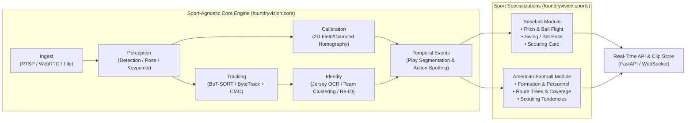

# FoundryyyVision

**Real-Time Sports Video Intelligence, Tracking, Identity & Scouting Platform**

FoundryyyVision is a modular computer vision platform built for real-time multi-object tracking, player/individual identification, action & activity recognition, and automated scouting across two specialized play-by-play domains:

1. **Baseball** — Pitch trajectory & physics, bat/swing mechanics, catcher/glove framing, baserunning/fielding events, and scouting metrics.
2. **American Football** — Pre-snap offensive/defensive formation & personnel recognition, line-of-scrimmage & yard-line homography (All-22 / Sideline / Endzone), snap-to-whistle play segmentation, route tree reconstruction, trench/impact detection, and scouting tendencies.

---

## Architecture Overview



---

## Repository Layout

```text
FoundryyyVision/
├── docs/
│   └── ARCHITECTURE.md                   # Open-source scouting references & system design
├── src/foundryvision/
│   ├── core/                             # Sport-agnostic real-time vision pipeline
│   │   ├── schema.py                     # Unified Frame, Detection, Track, Pose, PlayEvent schemas
│   │   ├── pipeline.py                   # Real-time orchestrator connecting core stages to sport plugins
│   │   ├── ingest/                       # Video stream readers & frame ring-buffers
│   │   ├── perception/                   # Object, keypoint, and pose detector interfaces
│   │   ├── tracking/                     # Multi-object tracking (ByteTrack/BoT-SORT + CMC)
│   │   ├── calibration/                  # Planar homography & camera-to-field coordinate transforms
│   │   ├── identity/                     # Team clustering, jersey OCR, and appearance Re-ID
│   │   └── events/                       # Play segmentation & temporal action spotting
│   ├── sports/                           # Domain-specific plugins & scouting engines
│   │   ├── base.py                       # Abstract SportPlugin contract
│   │   ├── baseball/                     # Pitch/bat/glove tracking, pitch-by-pitch state, scouting
│   │   └── football/                     # Pre-snap formation, LOS, routes, run/pass, scouting
│   ├── api/                              # FastAPI + WebSocket real-time telemetry server
│   └── cli.py                            # CLI entry point for running pipelines & benchmarks
└── tests/                                # Unit & integration test suite
```

---

## Quick Start

```bash
# Install in editable mode with dev dependencies
pip install -e ".[dev]"

# Run the test suite
pytest

# Run a simulated pipeline pass via CLI
foundryvision --sport football --frames 30
foundryvision --sport baseball --frames 30
```
